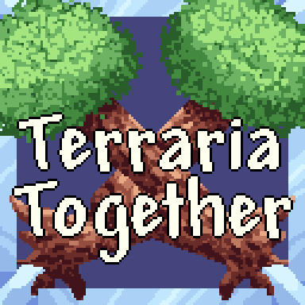
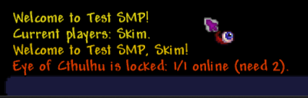
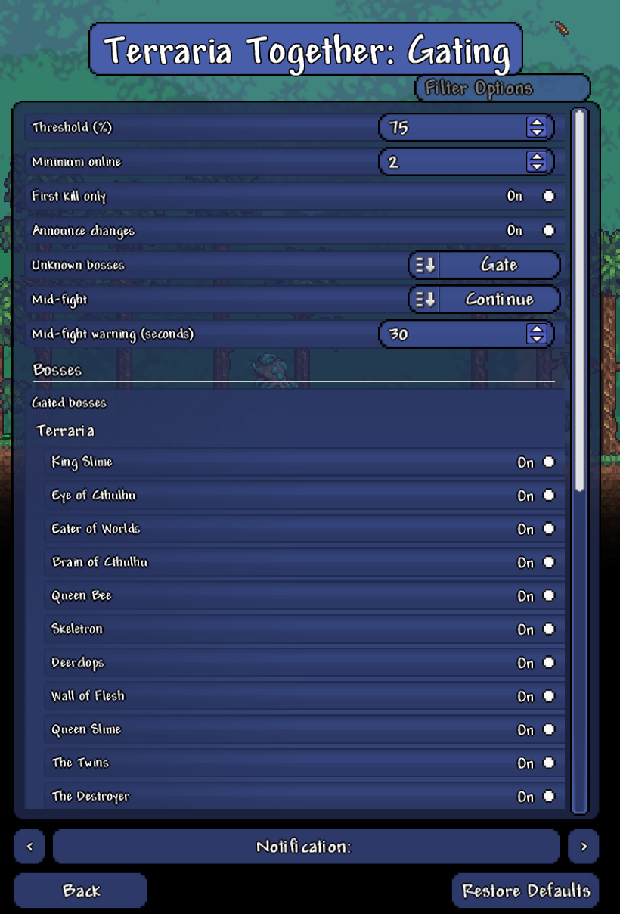
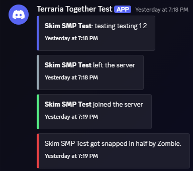

<p align="center">
  
</p>

<h1 align="center">Terraria Together</h1>

<p align="center">
  A tModLoader mod that turns a Terraria server into a survival multiplayer (SMP) world for a group of friends.
</p>

<p align="center">
  
</p>

## Features

- **Boss gating**: bosses and events stay locked until enough of the group is online (75% of members and at least 2 players by default), so nobody gets far ahead of everyone else. Summon items aren't used up while a boss is locked, and their tooltip shows how many more players are needed.
- **Works with modded bosses**: bosses from Calamity, Thorium and other content mods are gated automatically when Boss Checklist is installed. Anything else flagged as a boss is caught by a fallback.
- **Admin control**: admins turn modules and single bosses on or off with checkboxes in **Server Settings**, or lock and unlock bosses with `/smp gating lock` and `/smp gating unlock`.
- **Stats**: playtime, deaths, boss kills and PvP kills for each player, with a top 5 leaderboard.
- **Welcome and rules**: a welcome message on every join, the server rules on first join, and an optional step where players must accept the rules before they can build.
- **Discord log**: joins, leaves, chat, deaths and first boss kills are posted to a Discord channel, each in its own colored box with the time.
- **Modular**: every feature is a module that can be switched off without affecting the others.

<p align="center">
  
  
</p>

## Install

1. In tModLoader, open **Workshop** → **Download Mods**, search for **Terraria Together** and click **Download**.
2. Enable it in **Workshop** → **Manage Mods**, on the server and on every player's game.

Requires tModLoader (free on Steam if you own Terraria). Nothing else needs installing. Boss Checklist is optional and only needed to gate modded bosses.

Settings are stored on the server in `Documents/My Games/Terraria/tModLoader/ModConfigs/` (`TerrariaTogether_*.json`). The roster, stats and boss overrides are saved with each world.

## Getting started

1. Create a world and join it first. The first player to join a world is added to **Admins** automatically.
2. Open **Settings** → **Mod Configuration** → **Terraria Together** to set the gating threshold, rules and which modules are on.
3. Type `/smp help` in chat to see the commands. Admins see an extra list of admin commands.

Every option and command is described in [docs/CONFIG.md](docs/CONFIG.md).

## Does it work in single player?

Yes, but gating and the build-before-accepting-rules block are skipped, since there's no group to wait for. Stats, the welcome message and the rules still work, which is handy for previewing your settings.

## Is my Discord webhook safe?

The webhook URL is never added to the mod's settings, because those are sent to every player who joins. It's kept in its own file on the server (`ModConfigs/TerrariaTogether_DiscordWebhook.txt`), which `/smp discord url` writes for you. In-game `@everyone` and `@here` never ping anyone in Discord.

One thing to know: tModLoader writes every web request into `server.log`, including the webhook URL. Delete the `Web Request:` lines before sharing your log anywhere.

## Notes and limits

- **Players are told apart by their client ID**, not their character name. Two games on the same PC can share an ID and count as one member; check with `/smp whoami`.
- **Old One's Army**: the Eternia Crystal is used up even when the event is locked. The event is still stopped the moment it starts.
- **Bosses beaten before Discord log was turned on** are announced as a first kill once more on their next kill.
- **Accepting the rules** blocks placing and breaking blocks and walls, not paint, wires or liquids. It's a polite gate, not anti-griefing.
- **Discord rate limit**: Discord accepts about 30 posts a minute per webhook. During a burst of chat, extra posts are dropped and a warning is logged.

## Build from source

Requires [tModLoader](https://store.steampowered.com/app/1281930/tModLoader/) and the [.NET 8 SDK](https://dotnet.microsoft.com/download/dotnet/8.0). The project must sit in `Documents/My Games/Terraria/tModLoader/ModSources/TerrariaTogether/`.

```sh
# compile and package the mod (close tModLoader first, or use Develop Mods -> Build in game)
dotnet build

# then in tModLoader: Workshop -> Develop Mods -> Build + Reload to load it
```

The test plan for a local dedicated server is in [docs/TESTING.md](docs/TESTING.md).

### Tech

- C# on tModLoader (.NET 8).
- Optional cross-mod support through [Boss Checklist](https://steamcommunity.com/sharedfiles/filedetails/?id=2669644269) and a public `Mod.Call` API ([docs/API.md](docs/API.md)), with no hard dependencies.
- The server makes every decision; clients only show state the server sends them and run cheap checks so items aren't wasted.
- Packet routing by module ID, versioned world save data per module, and a webhook sender that posts in order without blocking the game.
- Lock decisions come from a pure function (`LockEvaluator`) that takes a snapshot and never touches game state.

```
Core/         module system, roster and presence, admins, /smp command, packets, Mod.Call API
Modules/
  Gating/     boss and event locking, boss registry, Boss Checklist import
  Stats/      playtime, deaths and kills, leaderboard
  Rules/      welcome message, rules, accept-to-build
  Discord/    webhook posts
Localization/ all player-facing text
docs/         config reference, API, test plan, module ideas
```

## License

[MIT](LICENSE)
